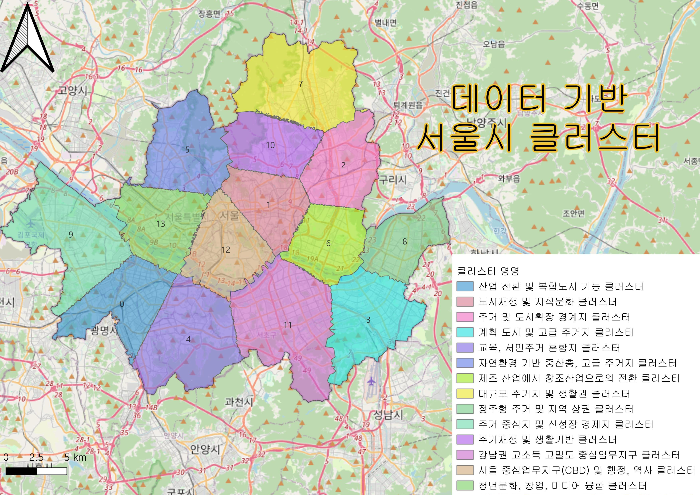

# GIS_Project

*2025년 1학기 수업 팀 프로젝트의 결과 지도입니다. 이 지도는 아래 [알려진 한계](#알려진-한계-known-issues)를 감안해서 봐 주세요.*

## 프로젝트 개요

**서울시 건물물리정보 기반의 공간 군집 분석**

### 1. 분석 배경 및 목표

기존의 서울시 공간 군집 분석은 대부분 인구, 소득, 연령 등 인구사회학적 데이터를 기반으로 이루어졌으며, 그 결과로 강남3구(강남, 서초, 송파), 강북지역, 영등포 등과 같이 이미 널리 알려진 공간 클러스터들이 반복적으로 등장하는 경향이 있습니다.
하지만 우리는 **서울을 물리적인 건축 환경의 관점에서 새롭게 바라볼 수는 없을까?** 라는 문제의식에서 출발하였습니다.
따라서 이번 프로젝트의 목적은 **서울시의 건물정보를 기반으로 공간 군집을 시도함으로써, 물리적 도시구조의 패턴을 발견하고 이를 해석**하는 것이었습니다.

---

### 2. 데이터 및 변수

분석에는 **서울시의 용도별 건물정보 데이터(shapefile)** 를 활용하였으며, 각 건물의 위치와 속성이 포함되어 있습니다.
그중 다음 5개 변수를 군집분석에 사용했습니다.

* **용적률** (Floor Area Ratio)
* **건폐율** (Building Coverage Ratio)
* **건물 높이** (in meters)
* **총 층수** (지상 + 지하)
* **건물 나이** (현재 연도 - 승인일자)

---

### 3. 1차 군집 분석: GEO-SOM

첫 번째 방법으로 **GEO-SOM** 알고리즘을 사용했습니다. 논문의 의사코드를 AI 도구로 구현한 `utils.py`를 사용했습니다.

* 20x20 격자를 구성해 건물 데이터를 학습시켰고, 각 건물은 격자의 노드(군집)에 할당되었습니다.
* 각 건물을 포인트로 시각화하고, 이 포인트들로 **보로노이 다이어그램(Voronoi Polygon)** 을 생성했습니다.
* 보로노이 각 셀에 해당 군집 번호를 할당해 군집 지도를 구성했습니다.

관찰한 문제:

* 군집의 수가 많고 공간적으로 흩어져서, 지도로 해석하기 어려울 만큼 세분화된 결과가 나왔습니다.
* 그래서 군집을 줄이는 2차 단계를 추가했습니다.

---

### 4. 2차 군집 분석: K-Means + Gap Statistic

1차 결과를 줄이기 위해 **K-Means** 를 적용했습니다.

* K-Means 입력은 4차원입니다: 각 건물의 보로노이 중심 좌표 (x, y)와, 같은 GEO-SOM 군집에 속한 건물들의 평균 위치 (x′, y′). 즉 **건물 속성이 아니라 위치 좌표**입니다 (코드 재확인 결과, 아래 한계 2 참고).
* 군집 수는 **Gap Statistic** 으로 탐색했고, 서울 전체에서 k=14가 선택되었습니다 (한계 3 참고).

---

### 5. 의의와 한계

* 인구통계가 아닌 건축 물리정보로 도시를 나눠 보려는 시도였습니다.
* 다만 아래 한계 때문에, 이 결과를 "건물 물리 특성에 따른 군집"이라고 확정해서 읽으면 안 됩니다.

---

## 알려진 한계 (Known issues)

프로젝트를 끝낸 뒤 AI 도구로 코드를 다시 읽으면서 지적된 한계입니다. 이 한계들은 AI 도구가 먼저 지적했고, 그중 1번과 3번의 일부(아래에 적은 범위)는 제가 회기동 규모(건물 783개)로 직접 다시 실행해 확인했습니다(2026-11). 서울 전체는 다시 돌리지 않았고, 2번과 4번은 코드 독해와 결과물 검토에 근거합니다.

1. **GEO-SOM의 지리 가중치가 의도대로 작동하지 않았습니다.** 지리적 승자 노드를 정할 때 입력 좌표(EPSG:5179, 미터 단위)와 격자 번호(0~19)를 같은 척도로 비교해, 지리 항이 한 노드로 쏠립니다. 회기동 규모에서 시드 3개로 학습했을 때 건물 783개 전부가 같은 노드(399번)를 지리적 승자로 골랐습니다(승자는 좌표와 격자 구조로 정해져 시드와 무관합니다). 따라서 지리적 요소가 군집에 반영됐다고 보기 어렵습니다. 같은 데이터에서 원본 코드를 `fixed_geo=False`로 돌리면 최종 군집이 1개로 합쳐졌는데, 원인은 확인하지 못했습니다.
2. **2차 K-Means의 입력은 건물 속성이 아니라 위치입니다.** 입력 4차원이 모두 좌표이고 스케일링도 없어서, 최종 군집은 주로 위치로 서울을 나눈 결과일 가능성이 큽니다.
3. **군집 수 14는 탐색 범위의 끝값입니다.** Gap Statistic을 k=1~14까지만 계산해 최댓값을 골랐고 곡선이 끝까지 올라서, 더 큰 k가 나았는지 알 수 없습니다. 최댓값 선택(1-SE 규칙 없음)이고 기준 표본도 3개로 적습니다. 회기동 데이터에서 `maxClusters`를 15와 30(실제 탐색 상한은 14와 29)으로 바꿔 5회씩 돌렸더니 선택된 k가 각각 11~14, 26~29로 상한을 따라 늘었습니다. 이 경향까지만 확인했습니다. 서울 데이터에서 같았는지는 다시 돌리지 않아 확인하지 못했습니다.
4. 군집 해석은 정량 지표(양자화 오차, 실루엣 등) 없이 지도와 지역 지식으로 작성했습니다.

**수정 방향:** 지리 가중치는 데이터 좌표로, 허용 범위는 격자 거리로 분리하면 회기동 규모에서 지리적 승자가 148개 노드로 흩어지는 것을 확인했습니다(군집은 약 140개로 더 잘게 나뉘어, 군집 품질이 좋아졌다는 뜻은 아닙니다). K-Means 입력에 건물 속성 포함, 군집 수 탐색 범위 재검토, 정량 지표 추가는 아이디어 단계이며 실행하지 않았습니다.

---

## 파일 구성

* `GIS_Project_GEO_SOM.ipynb`: 서울시 건물정보로 GEO-SOM을 학습하고, 할당된 군집을 보로노이 폴리곤으로 면적화합니다.
* `GEO_SOM_Seoul_K_Means.ipynb`: GEO-SOM 군집을 K-Means로 다시 묶고, Gap Statistic으로 군집 수를 탐색합니다.
* `GEO_SOM_Sample_play.ipynb`: 회기동 규모(작은 데이터)로 같은 흐름을 짧게 돌려 보는 시험용 노트북입니다. 학습이 약 1분대로 끝나서, 위 한계를 직접 확인해 보기 좋습니다. 입력 건물 데이터는 용량 때문에 올리지 않았고, `data/hoegiDong.zip`은 회기동 경계 shapefile입니다. 건물 데이터(파일명 `AL_D198_11230_...`, 동대문구)는 노트북 "Data Acquisition" 절에 적힌 공개 데이터 출처에서 받아 노트북의 경로에 맞게 두면 됩니다.
* `P05_repro_colab.ipynb`: 위 한계 1·3번을 회기동 규모로 다시 돌려 확인한 Colab 실행본(출력 포함)입니다. 원본 `utils.py`와 지리 가중치·격자 거리를 분리한 수정본을 비교하고, 판정 기준은 실행 전에 정해 코드에 고정했습니다.
* `utils.py`: GEO-SOM, 보로노이 폴리곤 자르기, Gap Statistic 함수 (노트북에서 함수만 불러 씁니다). Gap Statistic 함수는 Kaggle에 공개된 코드를 가져온 것입니다.
* `최종지도01~03.jpeg`: 결과 지도.
